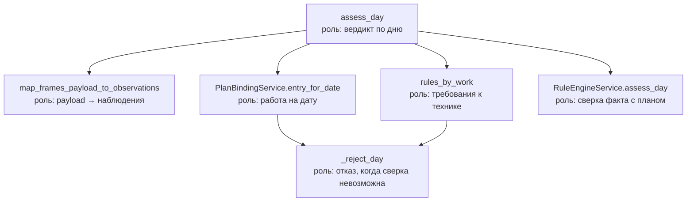

# Сценарии фасада

`SiteMonitoringFacade` — единственный публичный вход в домен. Фасад не обращается
к файлам, HTTP и моделям напрямую: он вызывает сервисы и мапперы.

## Методы

| Метод | Вход | Выход | Назначение |
| --- | --- | --- | --- |
| `assess_day` | `dict` со снимками за дату | `DayAssessment` | Вердикт «соответствие / отклонение» по одному дню плана |
| `assess_day_from_images` | `dict` с путями к снимкам | `DayAssessment` | То же, но снимки разбираются моделями внутри сервиса |
| `assess_stage` | `work_id` и вердикты по дням | `StageForecast \| None` | Темп этапа, прогноз завершения и отставание |

## Граф вызовов

## Шаги основного сценария `assess_day`

1. **Сырой вход → DTO.** Список снимков с находками детектора и ответами VLM
   превращается в `FrameObservation`. Дальше по потоку сырых словарей нет.
2. **Дата → работа плана.** `PlanBindingService` ищет запись календарного плана.
   Если даты в плане нет, сценарий завершается отказом `NO_DATA`.
3. **Работа → правила.** Из правил берётся набор `WorkPosition`: признак работ,
   позиции комплекта и сопутствующая техника.
   Если правил для вида работ нет, сценарий завершается отказом.
4. **Сверка.** `RuleEngineService` сопоставляет наблюдения с требованиями и
   возвращает вердикт с перечнем отклонений.

## Шаги сценария `assess_stage`

1. **Границы этапа** берутся из календарного плана: дата начала и плановая длительность.
2. **Продуктивные сутки** — дни этапа, признанные соответствующими плану.
3. **Прогноз** считается сервисом `ForecastService` по формуле методики:
   `темп = продуктивные / прошедшие`, `завершение = начало + длительность / темп`.

## Шаги сценария `assess_day_from_images`

1. **Дата → работа и правила.** Если даты нет в плане или правила не заданы, сценарий
   завершается отказом.
2. **Каждый снимок → наблюдение.** `EquipmentRecognitionService` прогоняет кадр через
   детектор и VLM: наличие известных классов берётся от детектора, остальные типы и
   состояние «работает / простаивает» — от модели.
3. **Сверка** тем же `RuleEngineService`, что и в `assess_day`.
4. **Разбор фасада** для фасадных этапов: `_assess_facade` смотрит на признак
   `facade_check` у правил работы и, если он стоит, прогоняет каждый снимок через
   `FacadeReadinessService`. Результат кладётся в поле `facade_readiness` вердикта
   и на `is_compliant` не влияет — это отдельное измерение.

Если доступы к моделям не заданы, сервис распознавания не собирается, и метод
возвращает отказ — рабочим остаётся `assess_day` с готовыми находками на входе.

## Шаги сценария `observe_shift`

Разбор снимков смены моделями, без правил зачёта. Отделён от сборки ленты, чтобы
правила можно было менять и пересчитывать по кешу, не обращаясь к моделям заново.
Возвращает наблюдения по кадрам, сравнения пар и пункт плана.

## Шаги сценария `assess_shift`

1. **Дата → работа и правила.** Нет пункта плана, правил или распознавания — смена
   не разбирается, метод возвращает `None`.
2. **Каждый снимок серии → наблюдение** тем же `EquipmentRecognitionService`.
3. **Каждая пара соседних кадров → признаки работы.** `MotionObserver` спрашивает модель,
   сдвинулась ли машина, сменил ли положение рабочий орган, виден ли оператор.
   У последнего кадра пары нет, его слот остаётся без признака движения.
4. **Сборка ленты** в `ShiftTimelineService`: девять слотов по двадцать минут,
   в каждом до трёх полосок, засчитанные слоты складываются в отработанное время.

## Ветки отказа

| Ситуация | Поведение |
| --- | --- |
| Дата вне календарного плана | `DayAssessment` с отклонением `NO_DATA`, соответствия нет |
| Для вида работ не заданы правила | `DayAssessment` с отклонением `NO_DATA` |
| За день нет ни одного снимка | `RuleEngineService` возвращает `NO_DATA` |
| Обзор перекрыт на всех снимках | Информационное отклонение `LIMITED_VIEW`, соответствие сохраняется |
| Техника найдена, но не работает | Отклонение `IDLE_EQUIPMENT`, соответствия нет |
| Этап не фасадный либо веса не найдены | `facade_readiness` пустой, вердикт не меняется |
| Здание или ячейки в кадре не найдены | Снимок в измерение не попадает, отклонения нет |
| На слот не пришло снимка | Слот пустой и не засчитан, это отсутствие данных |
| В серии меньше двух кадров | Движение не измеряется, слоты остаются без зелёной полоски |

## `CameraWatchFacade.capture` — съёмка кадра

1. Находим камеру и её источник; нет файла или потока — отказ, а не пустой кадр.
2. Берём последовательность кадров вокруг нужной секунды: последний пойдёт в архив,
   предыдущие нужны вычитанию фона — по одному кадру движение не определить.
3. Прогоняем кадр через проверки охраны труда тем способом поиска людей, который задан
   камере. Проверки выключены или нет весов модели — это записывается заметкой, а не молча.
4. Если есть отметка, пишем короткий отрезок записи: по одному кадру спор не разрешить.
5. Кладём снимок с датой съёмки в EXIF и дописываем опись с находками.

## `CameraWatchFacade.prune_archives` — уборка по сроку хранения

Вызывается планировщиком на каждом обходе. Кадры старше срока уходят вместе с отрезками
записи, снятыми к ним: доказательство без кадра бессмысленно. Тем же сроком чистится
очередь приёмной — иначе нетронутая очередь копила бы вчерашние кадры.

## `CameraWatchFacade.send_to_main_service` — передача снятого

1. Берём из архива кадры, которые ещё не уходили.
2. Отправляем их приёмной основного сервиса по HTTP.
3. Только после ответа помечаем кадры переданными: иначе сбой сети потерял бы их навсегда.
