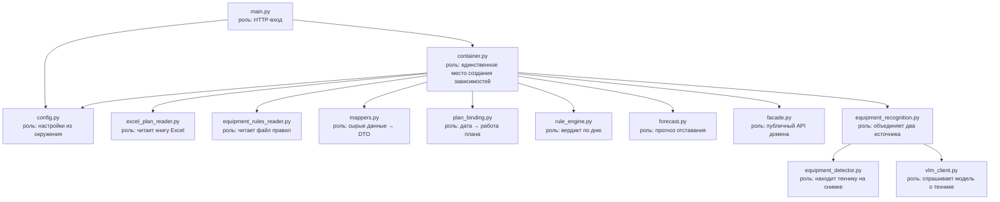
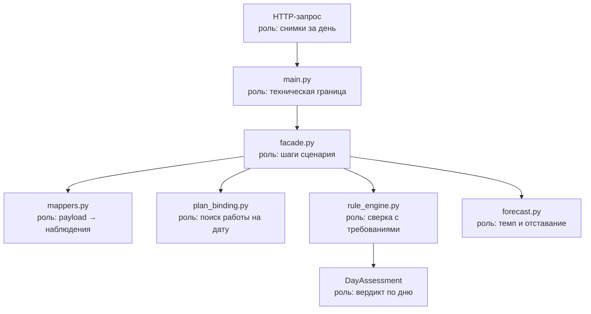

# Структура сервиса контроля строительных площадок

## Дерево репозитория

```text
hakaton_calendar_plan/
├── config/
│   ├── equipment_rules_v3.json    # правила этапа: признак работ, комплект, сопутствующая техника
│   ├── calendar_plan_new.json     # календарный план проекта: семь этапов на 294 дня
│   └── calendar_plan_shift.json   # сжатый план смен: по одному дню на вид работ подряд
├── data/
│   ├── photos_v2/                 # 26 снимков по этапам W01–W07
│   ├── photos_generated/          # 35 дорисованных вариантов исходных кадров
│   ├── photos_slots/              # серии смен: одна сцена, снимок раз в 20 минут
│   └── cache/                     # разобранные наблюдения, чтобы показ не ждал моделей
├── docs/
│   ├── service_structure.md
│   └── facade_flow.md
├── materials/                     # исходные материалы заказчика
├── models/
│   ├── rt_detr/                   # веса и код детектора техники, вне git
│   └── facade/                    # фасадные модели, тестовый набор и репозиторий авторов, вне git
├── scripts/
│   ├── build_calendar_plan.py     # сборка календарного плана проекта
│   ├── prepare_demo_photos.py     # раскладка снимков по этапам и запись EXIF
│   ├── run_demo_v2.py             # разбор снимков моделями в кеш, флаг --cached — пересчёт вердиктов
│   ├── build_demo_stand.py        # сборка самодостаточной страницы стенда
│   ├── build_process_diagram.py   # схема процесса в PNG для показа
│   ├── build_synthetic_series.py  # синтетические серии снимков для проверки правил
│   ├── convert_facade_weights.py  # перенос фасадных весов из mmdetection в torchvision
│   ├── build_slot_series.py       # раскладка кадров по 20-минутным слотам смены
│   ├── run_shift_demo.py          # прогон смены: признаки слотов в кеш
│   ├── build_shift_stand.py       # страница с лентой слотов
│   └── vlm_smoke_test.py          # проба подключения к VLM на реальном снимке
├── src/
│   ├── main.py                    # FastAPI: вердикт по дню плана
│   ├── config.py                  # настройки из переменных окружения
│   └── site_monitoring/
│       ├── container.py           # сборка зависимостей
│       ├── facade.py              # публичный API домена
│       ├── entity.py              # DTO домена
│       ├── mappers.py             # сырые строки и payload → DTO
│       ├── services/
│       │   ├── plan_binding.py            # дата → активная работа плана
│       │   ├── equipment_recognition.py   # объединение находок детектора и VLM
│       │   ├── rule_engine.py             # сверка факта с требованиями
│       │   ├── shift_timeline.py          # разбор смены на 20-минутные слоты
│       │   ├── position_matching.py       # сопоставление находок с позициями правил
│       │   ├── facade_readiness.py        # готовность фасада и нарушения по ограждениям
│       │   ├── facade_cell_layout.py      # снятие дублей ячеек и разбор на ряды
│       │   └── forecast.py                # темп этапа и прогноз отставания
│       └── adapters/
│           ├── excel_plan_reader.py       # чтение книги Excel
│           ├── equipment_rules_reader.py  # чтение файла правил
│           ├── calendar_plan_reader.py     # чтение календарного плана проекта
│           ├── detection_arbiter.py        # проверка рамок детектора моделью
│           ├── frame_synthesizer.py        # синтез похожих кадров из снимка
│           ├── equipment_detector.py      # RT-DETR: поиск техники на снимке
│           ├── facade_detector.py         # Faster R-CNN: здание и ячейки фасада
│           ├── barrier_classifier.py      # ResNet-18: нарушения ОТиПБ по ограждениям
│           ├── motion_observer.py         # сравнение пары кадров: работала техника или стояла
│           ├── model_answer_reader.py     # чтение булевых полей из ответа модели
│           ├── vlm_transport.py           # обращение к VLM: DeepSeek либо Yandex Cloud
│           └── vlm_client.py              # вопросы о технике по целому кадру
└── tests/
```

## Сборка зависимостей



## Два источника сведений о технике

| Источник | Что отвечает | Чем подтверждается |
| --- | --- | --- |
| `equipment_detector.py` | какие известные модели классы техники есть на кадре | рамка на снимке и уверенность |
| `vlm_client.py` | есть ли техника, которой детектор не знает, и работает ли найденная | текстовое обоснование модели |

Детектор даёт низкие абсолютные уверенности: в эталонных прогонах авторов весов
верные находки подписаны 0.05–0.10, поэтому рабочий порог — `0.05`, а не привычные `0.3`.
Состояние «работает / простаивает» детектор не определяет — это делает VLM.

## Поток выполнения



## Запрещённые связи

Проверяются скриптом контроля лимитов, в коде отсутствуют:

```text
facade   → container
services → facade | mappers | Settings
adapters → services | facade | mappers | Settings
mappers  → services | adapters
entity   → что угодно
config   → facade | services | adapters
```

Адаптеры не читают переменные окружения: путь к книге Excel и к файлу правил
приходит в конструктор из контейнера.

## Модель данных

- `Work` — вид работ справочника; `PlanEntry` — одна дата плана с активной работой.
- `WorkPosition` — позиция правил: вид (признак работ, комплект, сопутствующая),
  минимальное количество и набор альтернатив, любая из которых её закрывает
- `PositionAlternative` — один способ закрыть позицию: машина и источник признака
  (`detector` с классами модели либо `vlm` с вопросом), минимальное количество.
- `ObservedEquipment` / `FrameObservation` — что найдено на снимке и каким источником.
- `Deviation` / `DayAssessment` — отклонения и вердикт по дню.
- `StageForecast` — темп этапа, прогнозная дата завершения, отставание и статус.

## Фасадная ветка

Отдельное измерение готовности фасада, на соответствие дня плану оно не влияет.
Включается двойным гейтом:

1. **Календарный план.** Признак `facade_check` в `equipment_rules_v3.json` стоит только
   у фасадной работы W07. На котловане, сваях и плите фасада ещё нет, и гонять по ним
   фасадные модели незачем — это самый дешёвый гейт, он ничего не стоит.
2. **Детектор зданий** внутри самого разбора, порог 0.85. Здания в кадре нет — измерения
   нет, и это не отклонение, а признак того, что фронт работ не попал в кадр.

Внутри ветки: обрезка кадра по зданию → детектор ячеек → снятие дублей → подсчёт долей
монолит / блок / окно → классификатор ограждений по пустым проёмам выше нижнего ряда.

Перспективная трансформация авторов не воспроизводится: она берёт четыре точки из
калибровки камеры, которой у нас нет. На доли ячеек это не влияет, помешало бы измерению
геометрии.

Веса фасадных моделей лежат вне git. Если их нет на месте, `build_facade_readiness`
возвращает `None`, и ветка просто не включается.

## Смена по слотам

Модель показа: в день идёт один вид работ, смена три часа, снимок приходит раз
в двадцать минут. Три часа — это девять слотов.

Слот засчитывается, когда собраны три признака:

| Полоска | Признак | Как проверяется |
| --- | --- | --- |
| жёлтая | техника на месте | ведущая позиция правил закрыта на снимке слота |
| оранжевая | комплект собран | вторая или третья машина этапа появилась хотя бы раз за смену |
| зелёная | техника работала | между снимком слота и следующим что-то изменилось |

У последнего снимка серии следующего кадра нет, сравнивать не с чем, поэтому там
достаточно двух признаков. Слот без снимка не засчитывается — это отсутствие данных,
а не отклонение.

Движение определяется вопросом модели по паре кадров, а не сравнением координат рамок:
рамка детектора дрожит от кадра к кадру сама по себе, и правило по её смещению уже
засчитывало работу там, где техника не двигалась. Модель отвечает на три признака
отдельно — сдвиг машины, положение рабочего органа, человек в кабине.

Комплект собирают все позиции правил, кроме ведущей и признака работ: и комплект,
и сопутствующая техника. В правилах четырёх этапов из семи второй машины в комплекте
нет вовсе, она записана сопутствующей, и по одному только комплекту оранжевая полоска
там не зажглась бы никогда.

В кеш кладутся **сырые наблюдения**, а не готовая лента: правила зачёта меняются чаще,
чем данные, и `run_shift_demo.py --cached` пересобирает ленты без обращения к моделям.

Смены идут по сжатому плану `calendar_plan_shift.json`: каждому виду работ отведён один
день, следующий начинается на сутки позже. Полный план проекта на 294 дня не тронут и
по-прежнему используется для суточной сверки — путь к плану приходит в настройках.

Серия смены собирается **из одной сцены**: опорный снимок площадки и дорисованные из него
кадры. Прочие снимки этапа сняты на других площадках, и движение по ним не проследить.

## Контур наблюдения за камерами (`src/camera_watch/`)

Второй домен рядом с `site_monitoring`, со своим входом, фасадом и сборкой. Разделение
не формальное: контур наблюдения живёт на площадке и знает камеры, основной сервис живёт
на сервере и знает календарный план. Связь между ними одна — HTTP-передача снятых кадров,
поэтому контур можно унести на другую машину, не трогая разбор.

```
config/cameras.json ──► CameraRegistryReader ──┐
config/safety_checks.json ──► SafetyChecksReader ──┤
                                                   ├──► CameraWatchFacade ──► FrameArchive
VideoSource (ролик или поток) ─────────────────────┤            │
                                                   │            └──► MainServiceClient
ClipEncoder + MotionRegionFinder | PersonDetector ──┴──► SafetyAssessmentService
```

| Модуль | Назначение |
| --- | --- |
| `adapters/video_source.py` | кадр по позиции, последовательность кадров, поток JPEG, отрезок записи |
| `adapters/frame_archive.py` | снимки с датой съёмки в EXIF, опись находок, отметка об отправке |
| `adapters/clip_encoder.py` | CLIP ViT-B/32 из репозитория `video-monitoring`: кадр и фраза в одном пространстве |
| `adapters/motion_regions.py` | люди по вычитанию фона — для рисованных сцен симулятора |
| `adapters/person_detector.py` | люди детектором COCO из torchvision — для настоящих кадров |
| `adapters/main_service_client.py` | передача снятого основному сервису по HTTP |
| `services/safety_assessment.py` | контрастная оценка фраз «за» против «против», три исхода |
| `services/capture_planner.py` | сетка периодов съёмки и положение ролика во времени |

Вход контура — `src/camera_routes.py`, страницы — `src/camera_pages.py`. Приёмная основного
сервиса, куда контур отдаёт кадры, — `src/ingest_routes.py` и `src/ingest_pages.py`.

**Источник камеры — файл или адрес потока**, и ведут они себя по-разному. У живого потока
нет перемотки и нет «секунды ролика», зато открытие соединения стоит секунду-две, поэтому
его свойства запоминаются. Ролик крутится по кругу, и его положение считается от часов
сервера. Различие спрятано в `VideoSource`, наружу оно выходит одним признаком `is_live`.

**Два источника людей, и выбор за камерой.** `people_source` в описании камеры: `движение`
для рисованных сцен, `детектор` для настоящих. Обученная на фотографиях модель на рисованной
сцене не находит ничего, а вычитание фона на настоящем кадре путает человека с куском
движущейся техники. Единого способа, годного и там и там, у нас нет.

**Положение ролика считается от часов сервера**, а не от момента открытия страницы: иначе
двое смотрящих видели бы разные секунды одной камеры. Съёмка по расписанию идёт по ролику
с шагом — демонстрационные ролики длиной в минуту, а снимаем раз в двадцать минут, и без
шага весь архив состоял бы из одного кадра.
